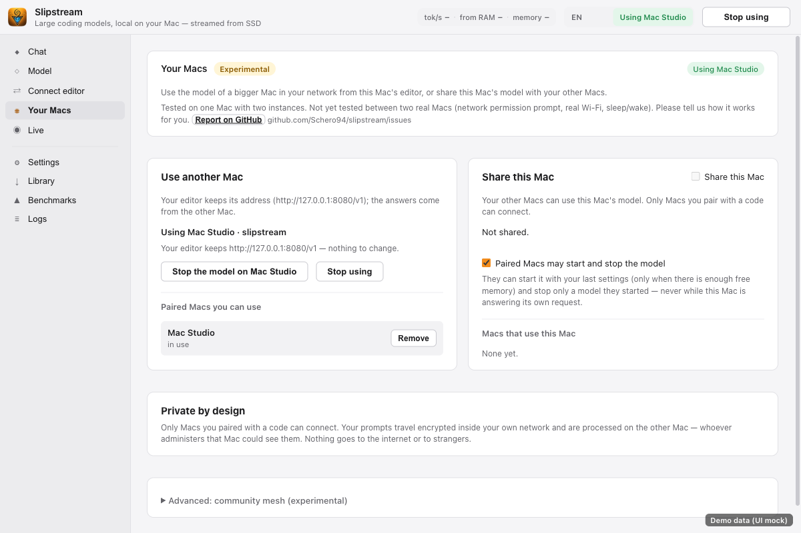

# Use your other Mac (v0.6, experimental)

> **Experimental.** Tested on one Mac with two instances. Not yet tested between two real Macs
> (network permission prompt, real Wi-Fi, sleep/wake). Please tell us how it works for you:
> [GitHub issues](https://github.com/Schero94/slipstream/issues).

Your MacBook's coding editor can use the model running on a bigger Mac at home or in the office
(a Mac Studio or Mac mini). The editor keeps its address, `http://127.0.0.1:8080/v1`; the answers
come from the other Mac. Only your own Macs, paired with a 6-digit code, can connect. Nothing goes
to the internet.



## How to use it (app)

On the **big Mac** (the one that runs the model):

1. Start the model as usual (Model tab → Start).
2. Open **Your Macs** and turn on **Share this Mac**. A 6-digit code appears (valid 5 minutes).

On the **MacBook**:

1. Open **Your Macs** → **Find my Macs**. macOS may ask whether Slipstream may find devices on your
   local network — allow it. (This question appears only after this click, never at app start.)
2. Type the code shown on the big Mac and press Enter. The MacBook switches to the big Mac at once;
   the top bar shows "Using Mac Studio".
3. If you have not connected your editor yet: **Connect editor** → Kilo Code or OpenCode. The
   setting it writes works for both the local model and the other Mac, so switching never needs a
   new setting.

Every day after that: nothing to click. The MacBook reconnects when the app starts. If the big Mac
sleeps, the MacBook tries to wake it and tells you when it cannot reach it; "Use this Mac's model"
switches back to the local model.

Not found? Under **Not listed? Enter its address** type the address shown under the code on the big
Mac. This also works over your own VPN. There is no relay server and no NAT traversal.

## How to use it (headless, e.g. a Mac mini without a screen)

```bash
# big Mac: llama-server already runs on 127.0.0.1:8080
slipstream-node pair --show-code          # prints a code (stop `share` first, or run it next to a running share)
slipstream-node share --forward-pid "$(pgrep -n llama-server)"   # forwards to http://127.0.0.1:8080 only while that process owns the port
# MacBook
slipstream-node pair --peer <fingerprint from `slipstream-node discover`> --code <6 digits>
slipstream-node use        # editors: http://127.0.0.1:8080/v1, API key = the content of <data dir>/local.token
```

`slipstream-node share` never starts a model by itself and never joins the community mesh. Without
`--forward-pid` it forwards only while the process on port 8080 runs under your own user account.
`slipstream-node use` requires the local API key by default (the same `local.token` the app uses;
`--token-file <path>` for another file, `--no-token` to switch it off — not recommended).

Pairing has a direction: the Mac that **shows** the code shares its model, the Mac that **types**
it uses that model. To use it the other way round as well, pair again with the code shown on the
other Mac.

## Privacy boundary

- **Who can connect:** only Macs you paired with a code. The code is checked with a password
  protocol (SPAKE2); a wrong code three times closes the window. Each Mac remembers the other's
  identity and refuses anyone else before reading a single request. Removing a Mac on either side
  disconnects it within a second.
- **What travels:** your prompts and the answers, encrypted between the two Macs (QUIC with
  TLS 1.3 and pinned identities, plus a second encrypted layer per request). Nothing goes to the
  internet or to us.
- **Who can read it:** the big Mac decrypts and processes your prompt — whoever administers that Mac
  could see it. Use it only with Macs you trust as much as your own.
- **What the big Mac's model can make your editor do:** your editor acts on the answers. With an
  agent (Kilo Code, OpenCode) that means the big Mac's model can drive the agent's tools on the
  MacBook — edit files, and run commands if you let the agent run them. Slipstream no longer sets
  "run shell commands without asking" in the editor settings it writes (earlier builds did); a value
  you set yourself is left as it is.
- **The pairing is one-way:** a Mac paired to *use* this one can never use the model the other way
  round, even if this Mac starts sharing later (both Macs check the direction).
- **What the other Mac can do:** only an allowlist of OpenAI-style requests is forwarded (chat and
  text completions, models, health, tokenize/detokenize/apply-template, a read-only `/slots` without
  prompt text, `/metrics`, a reduced `/props`). Saving or restoring the model's prompt files
  (`POST /slots/*`), changing server properties (`POST /props`) and everything else is refused on
  both Macs.
- **On the MacBook:** the forwarder listens only on `127.0.0.1` and `[::1]` and requires this
  install's local API key (the Connect-editor setting includes it). Other users and web pages on
  the MacBook cannot use it. The editor settings that contain the key are readable only by you
  (file mode 0600). **Connect editor → Regenerate key** makes a new key and updates the editor
  settings Slipstream wrote. If port 8080 is taken by another program, the app never sends the key
  there.
- **On the big Mac:** a paired Mac's requests reach only the app's own model process. If something
  else listens on port 8080 (for example after the model stopped), the request is refused with
  "the model is not running" and nothing is passed on. A paired Mac may start the model only with
  enough free memory (also for models that load fully into memory), on battery only if you allow
  it, and only the Mac that started it may stop it. The engine log is in
  `~/Library/Logs/Slipstream/engine.log`, readable only by you.
- **On the network:** the big Mac announces only a version, a short fingerprint and whether a pairing
  code is open (mDNS `_slipstream._udp`) — no names, no model, no RAM size. The MacBook never announces.
  The fingerprint stays the same while this Mac shares (until "Reset this Mac's identity"), so
  someone on the same network can recognise "the same Mac again", also on another network.
  Wake-on-LAN signals are sent only for the 20 seconds of "Waking…" and only when the MacBook is
  on the network where it last reached the big Mac — elsewhere nothing is broadcast.
- **What the answers reveal:** llama-server reports how much of a prompt it could reuse from its
  cache (`timings.cache_n`, `cached_tokens`). Slipstream passes answers on byte for byte, so a
  paired Mac sees these numbers, which hint whether a similar prompt was sent before (by anyone
  using the big Mac, including its owner). That is fine between your own Macs; it is one more reason
  not to pair Macs of other people.

## What was tested — and what was not

Tested on **one Mac** (M3 Pro, 36 GB) with two instances, each with its own identity and settings
(details and raw values: `bench/RESULTS.md`, "v0.6 M0"–"M5" and "v0.6 single-Mac qualification"):

- **Same answers:** chat answers, strict JSON and tool calls (forced, automatic and "required")
  through the other-Mac connection are identical to asking the model directly.
- **Long agent prompts:** a 39,515-token agent prompt read on the big Mac shows its progress on the
  MacBook the whole time (322 progress updates; the read-only progress view `/slots` also works through the connection).
- **Stop button:** stopping a long prompt in the editor stops the big Mac within 0.1 s (3 of 3 runs).
- **Big Mac freezes mid-answer** (process paused, our stand-in for sleep): the editor gets "The other
  Mac stopped answering." after 9.3 s, new requests get a "trying to wake it" message within 2 s, and
  the next request works as soon as the big Mac is back.
- **Speed:** no measurable cost on the same Mac — first word +10 ms on average (within the model's
  own ±50 ms jitter), writing speed 13.7 tok/s in both cases. With a simulated ~13 ms network
  round trip earlier: first word +13 ms, writing speed within 1 %.
- **Editor setup:** the Connect-editor button writes exactly the key the connection requires, and the
  standard streaming check passes through it.
- 0 MB swap; pairing, wrong codes, removing a Mac, version mismatch, packet loss (2 %) and the
  wake/asleep states are covered by automated tests (340 Rust, 119 app, 9 UI checks).

**Not tested yet (needs two real Macs):**

- the macOS **Local Network permission prompt** and the firewall with the shipped (ad-hoc signed) app,
  also after an update;
- **real Wi-Fi**: finding the other Mac on mesh routers or networks with access-point isolation,
  Wi-Fi delay and jitter;
- **real sleep and wake**: whether Wake-on-LAN / the Sleep Proxy actually wakes a sleeping big Mac,
  and a Mac going to sleep in the middle of an answer (simulated here by freezing the process);
- switching between Wi-Fi and Ethernet, or a VPN, while connected;
- two MacBooks on one big Mac, and a big Mac that also works locally at the same time
  (memory and swap on both);
- a full Kilo Code / OpenCode session over the network (tool calls, the stop button).

## Security review

A fresh review of all v0.6 code before the release found 0 critical, 5 medium and 6 low issues. All
were fixed, each with a regression test: pairing is now one-way (M1), the editor settings holding the
key are private and the key can be regenerated (M2), the big Mac forwards only to its own model
process and Slipstream no longer turns on shell auto-approval (M3), the list of paired Macs cannot
lose a removal when two programs change it at once (M4), and a stranger on the network can no longer
use up the three code attempts or the pairing slots (M5). Details: `bench/RESULTS.md`,
"v0.6 security review fixes".

## Tell us how it works

Please open an issue at <https://github.com/Schero94/slipstream/issues> with:

- both Macs (model, RAM, macOS version) and how they are connected (Wi-Fi / Ethernet / VPN);
- what you did and what happened (did the permission prompt appear? did "Find my Macs" see the
  other Mac? did the editor get answers? what happened when the big Mac slept?);
- the text of any message the app showed.

Please do **not** paste your prompts, your local API key (`local.token`) or the pairing code.
